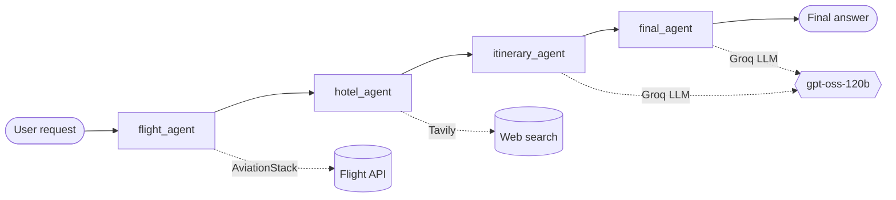

# Sypharis One

An AI travel planner built as a multi-agent system. You describe a trip in plain language, and a team of agents checks live flights, finds hotels, and writes a complete itinerary.

The project is being built in phases. Each phase upgrades the same application and lives on its own branch, so you can compare how the design changes.

| Phase | What it covers | Status |
|-------|----------------|--------|
| **1** | Multi-agent travel planner with LangGraph, **without MCP** | Done (this README) |
| **2** | Move the tools to **MCP** (Model Context Protocol) | Planned |
| **3** | Add a **Supervisor**, **Guardrails** and **Human-in-the-Loop (HITL)** | Planned |

> Phase 1 code lives on the `phase/withoutmcp` branch.

---

## Phase 1: Multi-agent travel planner (without MCP)

### What it does

Ask something like *"Plan a 5 day Japan trip from Delhi with hotels"* and the app returns:

- **Live flight data** for the route (airline, flight number, status, terminals, gates, delays)
- **Hotel suggestions** from a web search
- A **day-by-day itinerary** that is budget-aware
- A **final formatted plan** with trip summary, flights, hotels, itinerary, estimated budget and recommendations

Follow-up requests in the same conversation reuse the same `thread_id`, and conversation state is saved in PostgreSQL.

### How it works

Four agents run one after another in a LangGraph graph. They share a single state object.



| Agent | Uses | Job |
|-------|------|-----|
| `flight_agent` | AviationStack (no LLM) | Works out departure and arrival airports from the text, fetches live flights |
| `hotel_agent` | Tavily search (no LLM) | Searches the web for hotels matching the request |
| `itinerary_agent` | Groq LLM | Builds an itinerary from the flight and hotel results |
| `final_agent` | Groq LLM | Writes the final, formatted answer |

**Shared state** (`TravelState`): `messages`, `user_query`, `flight_results`, `hotel_results`, `itinerary`, `llm_calls`.

**Persistence:** a LangGraph `PostgresSaver` checkpointer stores each conversation thread in a PostgreSQL database (Render).

**Flight route parsing:** the flight tool understands plain requests such as `DAC to NRT`, `flights from Dhaka to Tokyo`, `Japan trip from Bangladesh`, or just `Japan trip` (which uses your default origin, Delhi). It is rule-based, with city, country and airport lookups, and no LLM is involved in that step.

### Tech stack

| Layer | Technology |
|-------|-----------|
| Agents | LangGraph, LangChain |
| LLM | Groq, model `openai/gpt-oss-120b` |
| Tools | AviationStack (flights), Tavily (web search) |
| API | FastAPI, Uvicorn |
| Database | PostgreSQL (Render) via `psycopg` |
| Tracing | LangSmith (optional) |
| Frontend | React 19, TypeScript, Vite, Tailwind CSS 4, shadcn/ui |
| Packaging | Docker, Docker Compose, nginx |

### Project structure

```
SypharisOne/
├── backend/
│   ├── app.py                FastAPI app, CORS, API routes
│   ├── agent.py              Builds the LangGraph graph, run_travel_agent()
│   ├── agents/               One file per agent + the shared state
│   │   ├── state.py
│   │   ├── flight_agent.py
│   │   ├── hotel_agent.py
│   │   ├── itinerary_agent.py
│   │   └── final_agent.py
│   ├── tools/
│   │   ├── flight_tool.py    AviationStack search + route parsing
│   │   └── tavily_tool.py    Tavily web search
│   ├── config/
│   │   ├── db.py             Database URL handling
│   │   └── groq.py           Groq LLM setup
│   ├── constants/
│   │   └── app_constant.py   Version and route paths
│   └── Dockerfile
├── frontend/
│   ├── src/
│   │   ├── App.tsx           Page layout and request flow
│   │   ├── components/       Composer, results tabs, loading steps, theme toggle
│   │   └── lib/api.ts        Backend API client
│   ├── Dockerfile
│   └── nginx.conf
├── docker-compose.yml        Runs frontend and backend together
├── .dockerignore
├── requirements.txt          Backend Python dependencies
├── .env.example              Template for your secrets
└── README.md
```

### API

Base URL: `http://localhost:8000`. Interactive docs are at `/docs`.

**`POST /api/v1/travel`** plans a trip.

Request:

```json
{
  "message": "Plan a 5 day Japan trip from Delhi with hotels",
  "thread_id": null
}
```

`thread_id` is optional. Send the one you got back to continue the same conversation.

Response:

```json
{
  "success": true,
  "thread_id": "user_3f2a...",
  "answer": "...final formatted plan (markdown)...",
  "flight_results": "...",
  "hotel_results": "...",
  "itinerary": "...",
  "llm_calls": 4
}
```

Errors return `{ "success": false, "error": "..." }` with status `400` (empty message) or `500`.

**`GET /api/v1/health`** returns `{"status": "ok", ...}`.

Example:

```bash
curl -X POST http://localhost:8000/api/v1/travel \
  -H "Content-Type: application/json" \
  -d '{"message": "Flights from Delhi to Dubai"}'
```

### Getting started

#### 1. Get your API keys

| Service | What for | Link |
|---------|----------|------|
| Groq | The LLM | https://console.groq.com |
| Tavily | Hotel / web search | https://tavily.com |
| AviationStack | Live flight data | https://aviationstack.com |
| Render PostgreSQL | Conversation storage | https://render.com (use the **External** database URL) |
| LangSmith (optional) | Tracing | https://smith.langchain.com |

#### 2. Create your `.env`

```bash
cp .env.example .env
```

Then fill in your values. `.env` is ignored by git, so your keys are never committed.

| Variable | Description |
|----------|-------------|
| `GROQ_API_KEY` | Groq API key |
| `TAVILY_API_KEY` | Tavily API key |
| `AVIATIONSTACK_API_KEY` | AviationStack API key |
| `AVIATIONSTACK_BASE_URL` | Flights endpoint. Free plan is HTTP only |
| `DEFAULT_ORIGIN_IATA` | Default departure airport, e.g. `DEL` |
| `DATABASE_URL` | Render PostgreSQL external URL (`sslmode=require` is added if missing) |
| `LANGSMITH_*` | Optional tracing settings |
| `CORS_ORIGINS` | Optional. Frontend URLs allowed to call the API (comma-separated) |

#### 3a. Run with Docker (recommended)

```bash
docker compose up --build
```

- Frontend: http://localhost:3000
- Backend: http://localhost:8000

The `.env` file is passed to the backend at runtime and is never copied into an image.

To point the frontend at a different API address, rebuild it with that address:

```bash
VITE_API_URL=https://api.example.com docker compose build frontend
```

Also set `CORS_ORIGINS` in `.env` to your frontend's address.

#### 3b. Run locally for development

**Backend** (Python 3.12):

```bash
python3 -m venv .venv
source .venv/bin/activate
pip install -r requirements.txt

cd backend
python3 app.py            # http://127.0.0.1:8000, auto-reload
```

Run backend commands from inside `backend/`. Its imports (`agents`, `config`, `tools`) are relative to that folder.

**Frontend** (Node 20.19+ and pnpm):

```bash
cd frontend
pnpm install
pnpm dev                  # http://localhost:5173
```

The frontend calls `http://127.0.0.1:8000` by default. To change it, copy `frontend/.env.example` to `frontend/.env` and edit `VITE_API_URL`.

### Frontend

A single-page app where you type a trip request and get the result in tabs: **Trip plan**, **Itinerary**, **Flights** and **Hotels**. It includes example prompts, a progress view while the agents work, a stop button, retry on errors, copy-to-clipboard, and light/dark mode.

### Known limitations (Phase 1)

These are the gaps the next phases are meant to address.

- **No ticket prices.** AviationStack returns live flight status, not fares. A pricing API (for example Amadeus) would be needed for real prices.
- **Fixed pipeline.** The agents always run in the same order. Nothing decides which agent is needed for a given request.
- **Tools are called directly in code.** There is no standard tool protocol, so adding or swapping a tool means editing the agents.
- **No guardrails.** User input and model output are not checked for safety, scope or quality.
- **No human approval step.** The system never pauses for confirmation before acting.
- **`llm_calls` counts every agent**, including the two that do not call the LLM, so a full run reports 4 although only 2 are real LLM calls.
- **Rule-based flight parsing.** Unusual phrasings or places outside the built-in city and country lists may resolve to the wrong airport.
- **Single request, no streaming.** The API answers once the whole pipeline is done, so the progress steps in the UI are a timer, not live status.
- **No authentication or rate limiting** on the API.

---

## Phase 2: MCP version (planned)

Move the tools (flights, search) behind MCP (Model Context Protocol) servers, so agents discover and call tools through a standard interface instead of direct function calls.

*Details will be added when this phase is built.*

## Phase 3: Supervisor, Guardrails and HITL (planned)

Add a supervisor agent that routes work to the right agents, guardrails that check inputs and outputs, and human-in-the-loop approval points.

*Details will be added when this phase is built.*

---

## Notes

- Never commit `.env`. Only `.env.example` (placeholders only) belongs in git.
- The backend image runs as a non-root user.
