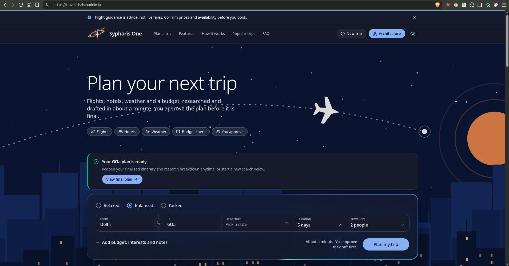
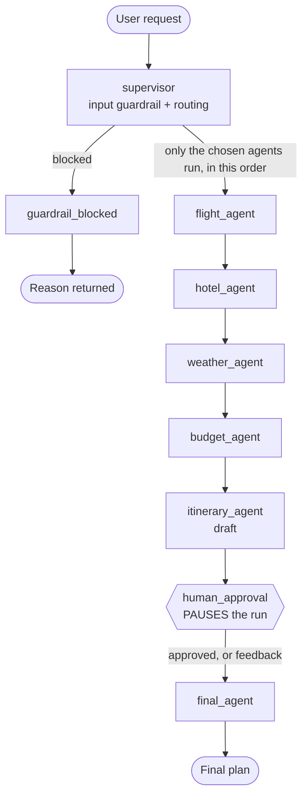

# Sypharis One

An AI travel planner built as a multi-agent system. You describe a trip in plain language. A supervisor checks the request and picks the specialist agents it needs, the agents gather flights, hotels, weather and a budget check, and an itinerary is drafted. **You review the draft** and approve it or ask for changes, and then the final plan is written.

**Live App:** [travel.shahabuddin.in](https://travel.shahabuddin.in)



The project was built in phases. Each phase upgraded the same application.

| Phase | What it covers | Status |
|-------|----------------|--------|
| **1** | Multi-agent travel planner with LangGraph, **without MCP** | Done, archived |
| **2** | Tools moved to **MCP** (Model Context Protocol), plus a weather agent | Done, archived |
| **3** | **Final version**: Supervisor, Guardrails, Human-in-the-Loop (HITL), React UI & Docker Postgres | Complete & deployed |

> Branches: Phase 1 is on `phase/withoutmcp` and Phase 2 on `phase/withmcp`.

---

## What it does

Ask something like *"Plan a 5 day trip from Delhi to Tokyo with hotels"*:

1. **Input guardrail:** requests that are not about travel (or are harmful) are blocked, and the reason is returned.
2. **Supervisor:** decides which specialists the request needs. The itinerary agent is always included.
3. **Specialists:** flights (AviationStack), hotels (Tavily), weather (OpenWeather) and a budget check.
4. **Draft itinerary:** built from everything gathered.
5. **Human approval:** the run **pauses** and waits. You approve, or reject with feedback.
6. **Final plan:** a polished answer with trip summary, flights, hotels, weather, day-by-day itinerary, estimated budget and recommendations. Your feedback is applied.

Each plan is saved in PostgreSQL under a `thread_id`, so a paused plan is stored in the database and can be resumed with that `thread_id`.

## How it works



| Agent | Uses | Job |
|-------|------|-----|
| `supervisor_agent` | LLM (2 calls) | First call: input guardrail. Second call: picks the specialists and extracts trip constraints |
| `guardrail_blocked_agent` | none | Ends the run with the guardrail's reason |
| `flight_agent` | AviationStack MCP + LLM | Gets airport and airline data, then asks the LLM for flight guidance |
| `hotel_agent` | Tavily MCP | Searches for hotels |
| `weather_agent` | Weather MCP (our own server) | Current weather and a short forecast for the destination |
| `budget_agent` | LLM | Checks whether the trip fits the budget, from the results so far |
| `itinerary_agent` | LLM | Builds the draft itinerary |
| `human_approval_agent` | none | Pauses the graph with LangGraph's `interrupt()` for a decision |
| `final_agent` | LLM | Writes the final plan and applies the human's feedback |

**Routing:** the supervisor returns a list of agents. After each specialist, `routing.py` sends the graph to the next chosen one, always in the order flight, hotel, weather, budget, then itinerary.

**Fail-open guardrail:** if the guardrail or supervisor reply cannot be parsed, the request is **allowed** and every specialist runs, so a formatting glitch does not break planning.

**When a tool fails:** if the hotel or weather server is unavailable, the agent leaves a note telling the later agents to give general advice and label it as non-live.

**Shared state** (`TravelState`): messages, the query, guardrail and supervisor fields (`guardrail_allowed`, `selected_agents`, `trip_constraints`, ...), the results of each agent, `itinerary`, the approval fields (`approved`, `human_feedback`), `final_response` and `llm_calls`.

**Persistence and pausing:** a LangGraph `PostgresSaver` checkpointer stores the state after every step. That is what lets the graph pause at the approval step and continue later when the API resumes the thread.

**LLM:** Groq `llama-3.3-70b-versatile` for every agent (set in `constants/agent_constant.py`).

## Tech stack

| Layer | Technology |
|-------|-----------|
| Agents | LangGraph, LangChain |
| LLM | Groq, model `llama-3.3-70b-versatile` |
| Tools | MCP servers: AviationStack (flights), Tavily (hotels), our own weather server (OpenWeather) |
| MCP client | `langchain-mcp-adapters` |
| API | FastAPI, Uvicorn |
| Database | PostgreSQL (Render) via `psycopg` |
| Tracing | LangSmith (optional) |
| Frontend | React 19, TypeScript, Vite, Tailwind CSS 4, shadcn/ui |
| Packaging | Docker, Docker Compose, nginx |

## Project structure

```
SypharisOne/
├── backend/
│   ├── app.py                  FastAPI app, CORS, API routes
│   ├── backend.py              Builds the graph; run_travel_agent() and resume_travel_agent()
│   ├── agents/                 One file per agent, plus shared pieces
│   │   ├── state.py            TravelState
│   │   ├── supervisor_agent.py     Input guardrail + choosing the specialists
│   │   ├── guardrail_blocked_agent.py
│   │   ├── flight_agent.py
│   │   ├── hotel_agent.py
│   │   ├── weather_agent.py
│   │   ├── budget_agent.py
│   │   ├── itinerary_agent.py
│   │   ├── human_approval_agent.py
│   │   ├── final_agent.py
│   │   ├── routing.py          Which agent runs next
│   │   └── helpers.py          LLM helpers, JSON parsing from model replies
│   ├── mcp/                    MCP client and servers
│   │   ├── mcp_client.py       Connects to the MCP servers, shared helpers
│   │   ├── flight_aviation_mcp.py
│   │   ├── tavily_mcp.py
│   │   ├── weather_mcp.py      Client side of the weather server + destination detection
│   │   └── weather_mcp_server.py   Our own MCP server (OpenWeather)
│   ├── config/
│   │   ├── db.py               Database URL handling
│   │   ├── groq.py             Groq LLM setup
│   │   └── paths.py            Puts backend/mcp on the import path
│   ├── constants/
│   │   ├── app_constant.py     Version and route paths
│   │   └── agent_constant.py   Model name and the agent order
│   ├── backup/                 Archived code, not used by the app
│   │   ├── agent_without_mcp.py    Phase 1 graph
│   │   ├── agent_with_mcp.py       Phase 2 graph
│   │   ├── backend_single_file.py  The final version before it was split into agents/
│   │   ├── mcp_client_unused.py    Two unused helpers removed from mcp_client.py
│   │   └── tools/                  Phase 1 tools: flight_tool.py, tavily_tool.py
│   └── Dockerfile
├── frontend/
│   ├── src/
│   │   ├── App.tsx             Page layout and request flow
│   │   ├── components/         Trip form, result view, Weather/Flights/Hotels cards, loading steps, theme toggle
│   │   └── lib/                api.ts (backend client), trip.ts (form to request), parse.ts (text to cards)
│   ├── backup/                 Unused frontend files (old chat-style input, template asset)
│   ├── Dockerfile
│   └── nginx.conf
├── docker-compose.yml          Runs frontend and backend together
├── .dockerignore
├── requirements.txt            Backend Python dependencies
├── .env.example                Template for your secrets
└── README.md
```

**Import note:** `backend/mcp/` has no `__init__.py` on purpose. A package named `mcp` would hide the real `mcp` library and break every MCP import. The agents import it through `config/paths.py`.

## API

Base URL: `http://localhost:8000`. Interactive docs are at `/docs`.

### `POST /api/v1/travel`: start a plan

Request:

```json
{
  "message": "Plan a 5 day trip from Delhi to Tokyo with hotels",
  "thread_id": null
}
```

`thread_id` is optional. Leave it out and a new one is created.

Response (the run stops at the approval step):

```json
{
  "success": true,
  "thread_id": "user_3f2a...",
  "requires_approval": true,
  "approval_request": "Please review the generated draft itinerary...",
  "answer": "...the draft itinerary...",
  "itinerary": "...",
  "flight_results": "...",
  "hotel_results": "...",
  "weather_results": "...",
  "budget_results": "...",
  "selected_agents": ["flight_agent", "hotel_agent", "weather_agent", "budget_agent", "itinerary_agent"],
  "trip_constraints": {"destination": "", "origin": "", "duration": "", "budget": "", "travel_style": "", "special_preferences": []},
  "supervisor_reasoning": "...",
  "guardrail_allowed": true,
  "guardrail_reason": "",
  "approved": false,
  "human_feedback": "",
  "llm_calls": 6
}
```

While `requires_approval` is `true`, `answer` is the **draft**. A blocked request returns `guardrail_allowed: false`, `requires_approval: false` and the reason in `answer`.

### `POST /api/v1/travel/approve`: approve or ask for changes

```json
{ "thread_id": "user_3f2a...", "approved": true, "feedback": "" }
```

- `thread_id` is required.
- When `approved` is `false`, `feedback` is required (otherwise `400`).
- The response has the same shape as above, with `requires_approval: false` and the **final plan** in `answer`.
- Approving the same thread twice returns the saved result without running the agents again.

### `GET /api/v1/health`

Returns `{"status": "ok", ...}`.

### Errors

Errors return `{ "success": false, "error": "..." }`: `400` for an empty message or a rejection without feedback, `422` for an invalid body, and `500` for anything else (for example an unknown `thread_id`: *"No saved travel plan found..."*).

### Try it

```bash
# 1. Start a plan (this pauses at the approval step)
curl -X POST http://localhost:8000/api/v1/travel \
  -H "Content-Type: application/json" \
  -d '{"message": "Plan a 5 day trip from Delhi to Tokyo with hotels"}'

# 2. Approve it, using the thread_id from step 1
curl -X POST http://localhost:8000/api/v1/travel/approve \
  -H "Content-Type: application/json" \
  -d '{"thread_id": "user_...", "approved": true}'
```

## Getting started

### 1. Get your API keys

| Service | What for | Link |
|---------|----------|------|
| Groq | The LLM | https://console.groq.com |
| Tavily | Hotel search (MCP) | https://tavily.com |
| AviationStack | Live flight data (MCP) | https://aviationstack.com |
| OpenWeather | Weather (our MCP server) | https://openweathermap.org/api |
| Render PostgreSQL | Plan storage and the approval pause | https://render.com (use the **External** database URL) |
| LangSmith (optional) | Tracing | https://smith.langchain.com |

### 2. Create your `.env`

```bash
cp .env.example .env
```

Then fill in your values. `.env` is ignored by git, so your keys are never committed.

| Variable | Description |
|----------|-------------|
| `GROQ_API_KEY` | Groq API key |
| `TAVILY_API_KEY` | Tavily API key |
| `AVIATIONSTACK_API_KEY` | AviationStack API key |
| `OPENWEATHER_API_KEY` | OpenWeather API key (used by the weather MCP server) |
| `DEFAULT_ORIGIN_IATA` | Default departure airport, e.g. `DEL` (used by the archived Phase 1 flight tool) |
| `DATABASE_URL` | Render PostgreSQL external URL (`sslmode=require` is added if missing) |
| `LANGSMITH_*` | Optional tracing settings |
| `CORS_ORIGINS` | Optional. Frontend URLs allowed to call the API (comma-separated) |

### 3a. Run with Docker

```bash
docker compose up --build
```

- Frontend: http://localhost:3000
- Backend: http://localhost:8000

The `.env` file is passed to the backend at runtime and is never copied into an image.

To point the frontend at a different API address, rebuild it with that address:

```bash
VITE_API_URL=https://api.example.com docker compose build frontend
```

Also set `CORS_ORIGINS` in `.env` to your frontend's address.

> The Docker setup was tested with the Phase 1 backend. The final backend starts the AviationStack and weather MCP servers as subprocesses (`uvx` downloads Python 3.13 on first use), and that has **not** been tested inside the container.

### 3b. Run locally for development

**Backend** (Python 3.12, and `uv`, which is in `requirements.txt`):

```bash
python3 -m venv .venv
source .venv/bin/activate
pip install -r requirements.txt

cd backend
python3 app.py            # http://127.0.0.1:8000, auto-reload
```

Run backend commands from inside `backend/`. Its imports (`from backend import ...`, `agents`, `config`, `constants`) are relative to that folder.

**Frontend** (Node 20.19+ and pnpm):

```bash
cd frontend
pnpm install
pnpm dev                  # http://localhost:5173
```

The frontend calls `http://127.0.0.1:8000` by default. To change it, copy `frontend/.env.example` to `frontend/.env` and edit `VITE_API_URL`.

## Frontend

Built with **React 19, TypeScript, React Router, Tailwind CSS 4, and shadcn/ui** (with light/dark mode and responsive layouts):

- **Routes (`/`, `/planning`, `/review`, `/plan`, `/architecture`):** Real client-side routing via `react-router`, preserving active drafts in `sessionStorage` across refreshes.
- **Trip Planner (`/`):** Frosted-glass search bar with animated border beam, shadcn/ui **Calendar** date picker and **Select** dropdowns, pace & interest chips, popular trip presets, and guardrail/error notices.
- **Draft Review (`/review`) & Final Plan (`/plan`):** Displays the day-by-day itinerary with Copy/Print controls, full-width budget breakdown & flight guidance, side-by-side Hotels & live Weather cards, and a sticky **Your decision** panel to approve or request revisions via `/api/v1/travel/approve`.
- **Architecture (`/architecture`):** Visual 4-layer system diagram explaining the frontend, FastAPI gateway, LangGraph workflow, PostgreSQL checkpoints, and MCP servers.

## Known limitations (final version)

- **The flight agent depends on tools your AviationStack plan may block.** It calls `list_airports` and `list_airlines`, which the plan used here rejects (`function_access_restricted`). The agent then gives the LLM the error text, and the model can invent airlines. The Phase 2 agent (`backup/agent_with_mcp.py`) reads the live departure board instead and avoids this.
- **No ticket prices.** AviationStack returns live flight status, not fares. The prompts label prices as estimates.
- **`llm_calls` is not exact.** It counts the hotel step (which makes no LLM call) and not the weather step, so a full run reports 7 while 6 model calls are made.
- **The guardrail only checks the input, and fails open.** There is no output validation, and an unparseable guardrail reply allows the request.
- **The weather destination comes from simple text matching,** not from the supervisor's extracted destination. Places outside its built-in country and city lists are not found, and the weather step is then skipped with a note.
- **Single request, no streaming.** The API answers once a step is done, so the progress steps in the UI are a timer, not live status.
- **No authentication or rate limiting.** Anyone who knows a `thread_id` can approve or resume that plan.

---

## Project history

### Phase 1: multi-agent planner without MCP

> Archived: `backend/backup/agent_without_mcp.py` and `backend/backup/tools/`. The complete working code is on the `phase/withoutmcp` branch. Its per-agent files were reused for the final version.

Four agents ran in a fixed line (flight, hotel, itinerary, final) over a shared state, with Groq `openai/gpt-oss-120b`. The tools were plain Python functions called directly: `flight_tool.py` (AviationStack plus rule-based route parsing, so `DAC to NRT`, `flights from Dhaka to Tokyo` or just `Japan trip` resolve to airports) and `tavily_tool.py` (web search). State was saved in PostgreSQL, so follow-up requests could reuse a `thread_id`.

### Phase 2: tools moved to MCP

> Archived: `backend/backup/agent_with_mcp.py`. The complete working code is on the `phase/withmcp` branch. The MCP client and servers it used are still in `backend/mcp/` and are used by the final version.

The tools now run behind MCP (Model Context Protocol) servers, and the agents call them through one client instead of calling Python functions. A weather agent was added, so the pipeline was: flight, hotel, weather, itinerary, final.

| MCP server | How it runs | Used for |
|------------|-------------|----------|
| AviationStack (`aviationstack-mcp`) | Started with `uvx` over stdio | Live flight information |
| Tavily | Remote server over streamable HTTP | Hotel search |
| Weather (`weather_mcp_server.py`) | Our own server (FastMCP), started as a subprocess over stdio | Current weather and forecast from OpenWeather |

- `mcp/mcp_client.py` is the hub: one `MultiServerMCPClient`, a helper that loads the tools of **one** server at a time (so a problem with one server does not stop the others), and a `call_mcp_tool()` helper that always returns text.
- **Phase 2 flight agent:** because the AviationStack plan blocks `list_airports` and `list_airlines`, it works out the airports from the sentence and reads today's live departure board through the MCP server. Fares and duration are labelled as estimates.
- The archived agents import `tools/`, which now lives in `backup/tools/`, so they do not run from `backup/` as they are. Use the branches above to run a phase.

---

## Notes

- Never commit `.env`. Only `.env.example` (placeholders only) belongs in git.
- The backend image runs as a non-root user.
- `backend/backup/` and `frontend/backup/` are archives. The app does not import them and does not need them to run.
